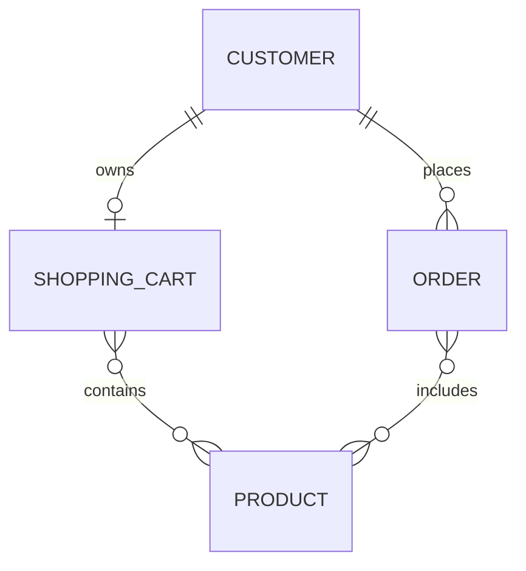

<div align="center">

# E-Commerce REST API

### A repository-based ASP.NET Core backend for store operations

`ASP.NET Core 8` · `Entity Framework Core 8` · `SQL Server` · `Repository Pattern` · `DTOs` · `Swagger`

</div>

## Overview

E-Commerce REST API provides backend endpoints for customers, products, shopping carts, and orders. The project demonstrates layered data access with repository interfaces, request/response DTOs, relational persistence, and Entity Framework migrations.

## Features

- Retrieve all customers or a customer by ID.
- Add customers and products.
- Create shopping carts.
- List, add, update, and delete orders.
- Map request and response data through dedicated DTOs.
- Manage SQL Server schema with EF Core migrations.
- Test endpoints through Swagger in Development.

## API reference

| Method | Endpoint | Description |
|---|---|---|
| `GET` | `/api/Customers/GetAllCustomer` | List customers |
| `GET` | `/api/Customers/{id}` | Get one customer |
| `POST` | `/api/Customers/AddCustomer` | Create a customer |
| `POST` | `/api/Products/AddProduct` | Create a product |
| `POST` | `/api/ShoppingCarts/AddShoppingCart` | Create a cart |
| `GET` | `/api/Orders/GetOrders` | List orders |
| `POST` | `/api/Orders/AddOrder` | Create an order |
| `PUT` | `/api/Orders/{id}` | Update an order |
| `DELETE` | `/api/Orders/{id}` | Delete an order |

## Data model



## Structure

```text
├── Controllers/       HTTP endpoints
├── DTOs/              API request and response models
├── Models/            Customer, Product, Cart, and Order entities
├── Repository/        Data-access contracts and implementations
├── Data/              Entity Framework DbContext
├── Migrations/        Database migrations
├── Program.cs         Dependency injection and HTTP pipeline
└── ECommerce.csproj   Project dependencies
```

## Getting started

### Requirements

- .NET 8 SDK
- SQL Server LocalDB or SQL Server
- `dotnet-ef` CLI tool

```bash
git clone https://github.com/MostafaMedhat19/E-Commerce-API-Project.git
cd E-Commerce-API-Project
dotnet restore
dotnet ef database update
dotnet run
```

Set `ConnectionStrings:DefaultConnection` in `appsettings.json` or User Secrets for your SQL Server environment. Then open `/swagger` on the application URL.

## Current scope and roadmap

This repository is an educational API foundation. Recommended production improvements include:

- JWT authentication and role-based authorization.
- Complete CRUD operations for products and carts.
- Input validation and standardized error responses.
- Pagination, filtering, inventory checks, and transactions.
- Unit/integration tests and GitHub Actions.
- Docker and environment-specific configuration.

## Author

[Mostafa Medhat](https://github.com/MostafaMedhat19)
